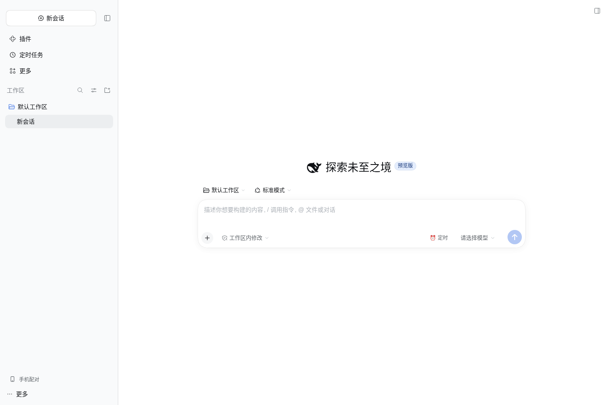
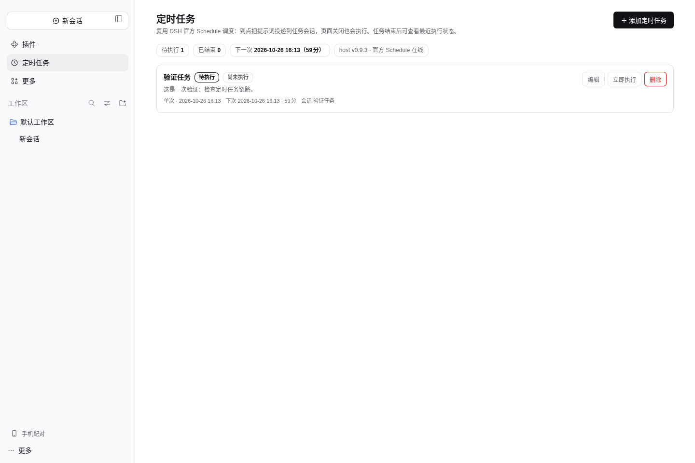
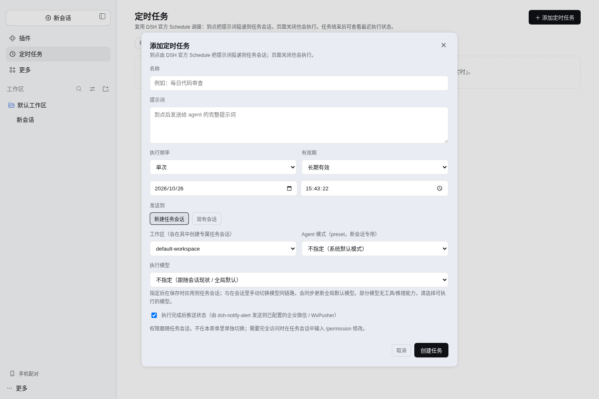

# dsh-scheduled-send

DSH 定时任务插件：给**提示词**设定发送计划（单次 / 每天 / 每周 / 固定间隔 / Cron），
到点由宿主**官方 Schedule 服务**投递进目标会话（常驻 host 进程，页面关闭仍触发）。
本插件不重写调度，只补官方没有的四件事——**管理表单、有效期、执行状态观察、通知联动**，
并让「定时任务」页取代官方「自动化任务」入口。

现行版本 **0.10.6**；版本历史见 [CHANGELOG.md](CHANGELOG.md)。

## 效果预览

侧栏「定时任务」入口（官方品牌区与收起按钮落位自 0.10.2 起由 `dsh-ui-shell` 集中接管）：



任务管理页（统计、待执行/已结束分组、行内操作）：



WorkBuddy 式创建表单（频率 / 有效期 / 目标会话 / Agent 模式 / 执行模型 / 通知）：



## 功能

**入口与管理**

- 侧栏「定时任务」独立页：**自定义任务 / 预置任务 tab 切换**（预置 = 插件或脚本以
  `builtin=true` 创建的默认任务，如工作台四报）、待执行/已结束分组、统计徽章（下次执行、
  host 与官方 Schedule 状态）、一键清理已结束任务（`deleteInactive`）。
- 创建/编辑弹窗字段：任务名称、提示词、频率（单次/每天/每周/固定间隔/Cron，时区默认本地）、
  有效期（长期有效 / 截止时刻）、**发送到**（新建任务会话 ⟂ 现有会话）、**Agent 模式**（preset，
  仅新会话可选——现有会话首轮后锁定，只读展示）、**执行模型**、执行完成推送开关。
- 聊天输入框工具行「⏰ 定时」：把当前草稿一键排成一次性任务；输入框上方 dock **只展示本会话的一次性（未触发/未投递完成）任务**——周期任务（每天/每周/间隔/Cron）常驻 dock 会让会话越开越乱，一律只在左侧「定时任务」页查看与编辑。
- 每行操作：编辑 / 立即执行（官方 `runNow` 投递）/ 打开会话 / 删除；展示最近执行结果与投递回执。

**调度与投递（全部复用官方）**

- 任务真身 = 官方 `ctx.schedule.create`（`at/after/every/daily/weekly/cron`），持久化在官方
  `storages/schedule.json`：重启自动恢复、错过自动补投，投递走原生 `user/message`
  （`source.kind='schedule'` framing）——插件不自建定时器、不重写队列语义。
- 新会话路径：`sessionController.create`（preset 在创建请求一步绑定 `agentPreset`）+ `rename`
  自动建任务会话；模型经公开方法 `sessionController.selectModel` 在保存时应用
  （与手动切换同链路，**会同步更新全局默认模型**，表单已注明；模型不可用即创建失败，不建半坏任务）。
- 有效期：`endsAt` 存插件 meta，到期（分片定时器）自动删除官方任务。
- 插件元数据 `<stateDir>/tasks-meta.json`（默认 `$DSH_HOME/profiles/<profile>/scheduled-send`）与
  官方任务表**对账式**合并：官方行为主，meta 缺失走默认，官方已删的行由 `reconcile` 清掉。

**执行状态与通知**

- 监听 `session/event`：`user/message(source=schedule)` 解析任务 id → 同轮 `assistant/message`
  留存摘要 → `turn/end` 按 `reason.kind` 归为 `success/failed/aborted/blocked/max-tokens/interrupted`，
  写回 meta 并刷新列表。
- 通知不落本插件：dsh-notify-alert ≥0.9.0 独立观察同一组官方事件，识别定时轮次后推送
  微信（企微 webhook / WxPusher）。两端只靠**官方事件契约**解耦，不建包依赖。
  全链路（定时投递→模型执行→手机收到推送）已在生产实测通过。

**侧栏品牌区处理**

- 经公开插槽 `sidebar.brand.name` / `sidebar.brand.mark` 注册替换实现：移除「DSH · 本地构建」标识；
  折叠轨道的展开按钮保留可见图标。
- 「收起侧栏」按钮无官方插槽，采用挂载标记类 + 纯 CSS 并入「新会话」行右端（不搬 DOM 节点，
  折叠/展开由官方逻辑原样驱动）；桌面版装了 ui-brand-official 时自动让位。

**安全边界**

- 路由 `/api/scheduled-send/*` exact 注册**绕过** `/api` 前缀鉴权，每条路由显式过
  `connection.requestRejection({headers})`：未登录 401、来源不信任 403；凭据 = 原生 `dsh-auth-*` cookie。
- 不修改上游；只消费公开扩展点（`ctx.schedule`、`sessionController`、`webServer.register`、
  `session/event`、`schedule/changed`、插槽）。
- 明确不做：图片/附件投递、跨设备同步、插件间包依赖；更细的多渠道路由归 notify-alert 设置。

## 隐藏官方「自动化任务」UI

官方调度服务保留、客户端 UI 禁用——profile patch（Ubuntu = `~/.dsh-dev/profiles/web/cordis.patch.yml`）：

```yaml
- id: ui-schedule
  disabled: true
```

只禁 `ui-schedule` 这一个 client 条目；host `schedule` 服务不受影响，官方任务照跑。

## 安装

一律 **tgz 安装**（不用 link）；与 dsh-notify-alert ≥0.9.0 同装才有执行状态推送：

```bash
pnpm check && npm pack        # 门禁构建 + 五组测试 + 打包 → dsh-scheduled-send-0.10.3.tgz

# Ubuntu 源码版（CLI 不在 PATH；脚本默认 DSH_HOME=~/.dsh-dev、profile=web）
DSH_CLI=<cli 绝对路径> ops/linux/install-plugin.sh \
  dsh-plugins/dsh-scheduled-send/dsh-scheduled-send-0.10.3.tgz --apply

# Windows 桌面版
"<安装目录>/resources/runtime/cli/bin/dsh.cmd" plugin --profile desktop add <tgz 绝对路径>
```

- 装完核对 `profiles/web/node_modules/dsh-scheduled-send/lib` 真实存在（`pnpm verify:installed`）。
- **重打包必须升版本号**（五处同步，见 [AGENTS.md](AGENTS.md)）；同版本重打包会被 pnpm 按
  integrity 判「已最新」，残留旧解压产物 → 启动即 `ERR_MODULE_NOT_FOUND`。
- 重启生效 **需用户同意**：Ubuntu `systemctl --user restart dsh-dev-web`；
  Windows 托盘退出后重开桌面应用。

## 构建与验证

```bash
pnpm check              # 门禁构建 + host/client typecheck + 五组测试（smoke/routes/opener/meta/hooks）
pnpm typecheck          # tsc --noEmit（host + client）
pnpm verify:installed   # 安装后验证（缺 lib/ / 扁平残留就地拦截）
pnpm e2e                # 端到端 API：node scripts/e2e-3082.mjs [base] --token <启动token>
                        # 探针任务「次日 03:07 单次」→ list/update/delete，不投递真实消息
```

- **三道防坏安装门禁**（构建期自动执行）：顶层布局卫生 / 产物可加载（host 导出断言 +
  client `__ModuleLoader__`、插件 id、插槽断言：`main key=scheduled-send`、`sidebar.panellist`、
  `conversation.input.right|dock`、`settings.section`、`sidebar.brand.name|mark`）/ 安装后验证。
- 不 import `@deepseek-ai/*` 类型包（构建解析不到）：宿主面用本地结构化接口声明
  （`bridge.ts` 的 `ScheduleServiceLike` 等）。
- 隔离实测：独立 home + 3084 端口实例，Playwright 断言（品牌移除、收起按钮并入新会话行且
  不重叠、折叠轨道展开标识可见、建表单条任务、console 零报错），脚本与截图在管理根
  `ops/validation/dsh-scheduled-send-0.8.0/`。

## 环境支持矩阵

| 环境 | 支持度 | 验证状态 |
|---|---|---|
| `ubuntu-4090`（源码构建，127.0.0.1:3082 + CF Tunnel 公网） | 全量 | **0.9.5 生产实装**（2026-10-26）：API e2e、Playwright UI、真实定时任务执行 + 微信推送全链路通过 |
| `windows-lite`（官方桌面版 profile `desktop`） | 全量 | **未在 Windows 实测**。调度跑在桌面 host 进程内，「离开电脑仍触发」前提是 dsh 进程保持运行；装完须**托盘退出后重开**才生效 |

- 数据层：官方 `storages/schedule.json`（任务真身）+ `<stateDir>/tasks-meta.json`（插件元数据），
  不依赖 MySQL/SQLite；无 Python / 本地模型依赖。
- 兼容基线：Node `^22.19.0 || >=24.0.0`；host 产物 target es2022；
  要求 deepseek-harness ≥ 0.2.1-rc.x 且官方 `schedule` 服务可用
  （依赖 `ctx.schedule.catalog/create/update/delete/deleteInactive`、
  `sessionController.create/rename/prompt/selectModel`、`session/event` 的 schedule framing、
  插槽 `sidebar.panellist` / `main(key)` / `conversation.input.right|dock` / `settings.section` /
  `sidebar.brand.name|mark`）。

## 文档索引

| 文件 | 一句话 |
|---|---|
| [docs/images/](docs/images/) | 效果截图（README 用，隔离实例生成） |
| [docs/README.md](docs/README.md) | 文档体系总览与阅读路径 |
| [docs/FILE_INDEX.md](docs/FILE_INDEX.md) | 全插件文档索引（每份一行） |
| [docs/glossary.md](docs/glossary.md) | 本插件术语表 |
| [docs/需求/BRD-业务需求说明书.md](docs/需求/BRD-业务需求说明书.md) | 需求记录（每轮反馈 → 设计决策 → 实现落点） |
| [docs/需求/BRD-001-complete-feature.md](docs/需求/BRD-001-complete-feature.md) 等 SDD 三件套 | 首发/体验期历史记录（0.7.x 形态，非现行规格） |
| [docs/测试/FTR-测试指南.md](docs/测试/FTR-测试指南.md) | 测试文档：单元 / 产物门禁 / e2e / 手工验收清单 |
| [docs/管理/RMP-风险管理.md](docs/管理/RMP-风险管理.md) | 事故与排障记录 |
| [docs/history/归档-20261013.md](docs/history/归档-20261013.md) | 历史归档（过期叙述原文，非现行手册） |
| [AGENTS.md](AGENTS.md) | 本插件专属硬规则（inject、鉴权、门禁、版本同步） |
| [CHANGELOG.md](CHANGELOG.md) | 版本变更记录 |

## 附：仓库与共用目录

代码真源 = **独立仓 `IamWWT/dsh-scheduled-send`（public，活跃）**；当前 checkout 物理位于
monorepo 目录 `dsh-plugins/dsh-scheduled-send/` 下，但**仍是独立 git 仓库**（不作为
`dsh-plugins`/管理根的 gitlink，不进 monorepo 的版本同步范围）。
遵循 [DeepSeek 共用目录约定](../../dsh-agent-presets/docs/DIRECTORY-LAYOUT.md)，管理根统一写作 `<DEEPSEEK_ROOT>`；
Bash/systemd 命令只适用于 `ubuntu-4090`。

## 周期任务与预置恢复（0.10.6）

周期任务不随投递会话归档消失。插件保存配置快照，官方归档停止原任务后，在原工作区创建新任务会话并交给官方 Schedule 重新排期。一次性任务保留官方归档停止行为；用户显式删除、截止到期不会自动复活。迁移改变官方任务 id，原投递历史留在原会话；不补投归档期间错过的执行。

预置任务页提供「暂停任务 / 恢复任务」，没有删除按钮。暂停不丢配置、不触发后续排期，不中断已经开始的模型执行；恢复后按周期重新排期。「恢复默认配置」先预览确认，仅更新或补齐预置任务，保留暂停状态，不影响自定义任务。基线为新版本首次接管时登记的配置，之后编辑不覆盖它。

插件状态目录新增 `task-protection.json`（周期配置、预置基线、暂停与迁移意图）及 `reset-backups/`（恢复前配置备份）。它们只保存在本机，不提交会话/提示词。调度、时间计算和投递仍全部走官方服务；插件不自建调度器。原工作区失效时保留配置并在列表提示错误，修复工作区后重试。

实现与验收见 [归档保护任务](docs/管理/PP-20261026-归档保护与默认恢复.md)。Ubuntu 隔离和生产结果以任务记录为准，Windows 未实测。
